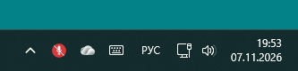
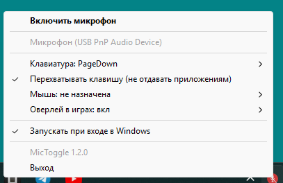
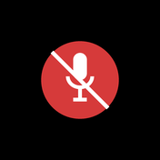

# MicToggle — микрофон в системном трее

Значок в трее, который одним кликом выключает и включает микрофон.



Цвет значка показывает состояние:

| значок | состояние |
|---|---|
| 🔴 красный, микрофон перечёркнут | микрофон выключен (mute) |
| 🟢 зелёный | микрофон включён, звука нет |
| 🟢 яркий зелёный с «волнами» | микрофон включён и слышит звук |
| ⚪ серый | микрофон недоступен (нет устройства или ошибка) |

* **левый клик** — выключить/включить микрофон;
* **PageDown** (настраивается) — то же самое из любой программы;
* **правый клик** — меню: состояние, устройство записи, горячие клавиши,
  автозапуск, выход.

Меню значка:



Windows 10/11, права администратора не нужны.

## Установка

Скачать `MicToggle-Setup-<версия>.exe` из
[releases](https://github.com/incomparableus-lang/MicToggle/releases) и запустить.
Установка идёт в профиль пользователя (`%LOCALAPPDATA%\Programs\MicToggle`),
без UAC. В установщике можно сразу включить автозапуск и ярлык на рабочем столе.
Удаление — «Параметры → Приложения» или `Uninstall.exe` в папке программы.

## Горячие клавиши

По умолчанию микрофон переключает **PageDown** (PgDn) — глобально, в любой
программе. Настраивается в меню значка:

* **Клавиатура: PageDown → Назначить…** — программа ждёт следующее нажатие;
  можно с модификаторами (Ctrl/Alt/Shift/Win). `Esc` — отмена, 10 секунд без
  нажатия — тоже отмена. **Отключить** убирает клавишу совсем.
* **Мышь: не назначена → Назначить…** — ловятся средняя кнопка (колесо) и
  боковые (назад/вперёд). Кнопка мыши работает одновременно с клавишей: обе
  срабатывают независимо.
* **Перехватывать клавишу** — если включено (по умолчанию), нажатие не
  доходит до других программ: PgDn не пролистывает страницы, а только
  переключает микрофон. Снимите галочку, если клавиша нужна и приложениям.
  Кнопка мыши всегда перехватывается, иначе она делала бы «назад» в браузере.

Назначения хранятся в `%LOCALAPPDATA%\MicToggle\config.json` и
подхватываются при запуске программы.

Клавиатура и мышь ловятся низкоуровневыми хуками Windows
(`WH_KEYBOARD_LL` / `WH_MOUSE_LL`), поэтому работают и без фокуса на значке.
Права администратора не нужны. Ограничение: клавиша с модификатором
срабатывает только с ровно тем набором модификаторов, который назначен
(Shift+PgDn не сработает, если назначен чистый PgDn).

## Запуск

Двойной клик по `MicToggle.vbs` (или по ярлыку `MicToggle.lnk`) — значок
появится в трее, окно консоли не открывается.

Командная строка:

```
.venv\Scripts\pythonw.exe mic_toggle.pyw          # повесить значок в трей
.venv\Scripts\pythonw.exe mic_toggle.pyw --toggle # разово переключить и выйти
```

`--toggle` удобно повесить на горячую клавишу: свойства ярлыка → «Быстрый вызов».

## Оверлей в играх

Меню значка → «Оверлей в играх»:

* **Показывать** — включить оверлей;
* **5 секунд после переключения** (по умолчанию включено) — после каждого
  переключения микрофона (клик по значку, `PgDn`, кнопка мыши) в углу на
  5 секунд всплывает значок с новым состоянием. Работает и на рабочем столе,
  чтобы переключение было видно всегда;
* **Только когда микрофон выключен** — постоянный значок висит только при mute;
* **Только в полноэкранных приложениях** (по умолчанию включено) — постоянный
  значок появляется, когда на весь экран развёрнута игра;
* **Положение** — правый/левый верхний/нижний угол;
* **Показать на 5 секунд** — проверить вид, не запуская игру.

Оверлей — **только значок, без текста**: красный перечёркнутый микрофон —
выключен, зелёный — включён, яркий зелёный с «волнами» — слышен звук, серый —
нет микрофона. Окно не забирает фокус, не мешает мыши (клики проходят сквозь
него), не попадает в Alt+Tab.

| Микрофон включён | Микрофон выключен |
|---|---|
|  |  |

Работает поверх игр в режиме «окно без рамки» (borderless windowed) и в окне.
Над **эксклюзивным полноэкранным** режимом (Fullscreen Exclusive) оверлея не
будет: это ограничение Windows, туда пробиваются только оверлеи с инъекцией
DLL (Steam/Discord), а инъекция в игру — и риск с анти-читом, и отдельная
нативная DLL. Поэтому в настройках игры стоит выбрать «Окно без рамки».

## Что именно выключается

Программа ставит **mute на устройство записи по умолчанию** (Windows Core Audio,
`IAudioEndpointVolume`). Это то же самое, что галочка «Выкл.» в параметрах звука:
все программы перестают слышать микрофон, но само устройство из системы не
исчезает — после включения всё сразу работает, ничего не надо переподключать.
Права администратора не нужны, устройство в диспетчере не меняется.

Активность определяется по пиковому уровню устройства записи
(`IAudioMeterInformation`): пока уровень выше порога, значок горит ярче и с
«волнами», после последнего звука — ещё 0,6 с.

Порог чувствительности (`PEAK_THRESHOLD`, по умолчанию 0.015 при шумовом поле
около 0.002) и время удержания (`LIVE_HOLD`) — константы в начале
`mic_toggle.pyw`. Если значок дёргается от шума — поднимите порог; если не
реагирует на тихую речь — опустите. Замерить свой микрофон можно скриптом
`tests\measure.py`.

Если в системе сменилось устройство записи по умолчанию (воткнули гарнитуру),
программа это замечает в течение 2 секунд и переключается на него — состояние
значка всегда отражает реальный микрофон по умолчанию, даже если mute нажали
из системных настроек или другого приложения.

## Сборка из исходников

```
py -3.12 -m venv .venv
.venv\Scripts\pip install -r requirements.txt
.venv\Scripts\pythonw.exe mic_toggle.pyw
```

Нужен Python 3.12 (у 3.14 пока нет стабильных колёс у `comtypes`).

Установщик собирается одной командой (нужен NSIS 3):

```
.\build.ps1            # версия из файла VERSION
.\build.ps1 -Version 1.0.1
```

`build.ps1` кладёт `dist\MicToggle\MicToggle.exe` (PyInstaller) и
`dist\MicToggle-Setup-<версия>.exe` (NSIS) с файлом контрольной суммы.

## Автозапуск

Меню значка → «Запускать при входе в Windows». Пишется значение `MicToggle` в
`HKCU\Software\Microsoft\Windows\CurrentVersion\Run`.

## Если значка не видно

Windows 11 прячет новые значки в «шторку» — нажмите `^` слева от часов.
MicToggle при первом запуске сам закрепляет свой значок на панели задач
(`IsPromoted=1` в `HKCU\Control Panel\NotifyIconSettings`). Если значок всё
равно спрятан: **Параметры → Персонализация → Панель задач → Другие значки в
системном трее** → включить MicToggle.

## Файлы

| файл | назначение |
|---|---|
| `mic_toggle.pyw` | сама программа (значок, меню, mute, автозапуск) |
| `hotkeys.py` | горячие клавиши: хуки клавиатуры и мыши, конфиг |
| `icons.py` | отрисовка значков (Pillow), ICO на все размеры |
| `overlay.py` | оверлей в играх: click-through окно поверх приложений |
| `MicToggle.vbs` | запуск без консоли из исходников |
| `MicToggle.spec` | сборка exe (PyInstaller) |
| `build.ps1` | сборка exe и установщика, контрольная сумма |
| `installer\MicToggle.nsi` | установщик (NSIS 3), установка в профиль пользователя |
| `VERSION` | текущая версия |
| `tests\smoke.py` | значки, меню, mute, автозапуск |
| `tests\hooks_check.py` | хуки: клавиша, автоповтор, мышь, режим назначения |
| `tests\hotkey_live.py` | горячая клавиша у запущенной программы |
| `tests\swallow_check.py` | перехват: доходит ли PageDown до обычного окна |
| `tests\overlay_check.py` | оверлей: размер, позиция, клики сквозь него |
| `tests\overlay_watch.py` | оверлей после переключения: показался и исчез |
| `tests\fullscreen_stub.py` | заглушка полноэкранного приложения для проверки оверлея |
| `tests\measure.py` | замер уровня микрофона |
| `log` | `%LOCALAPPDATA%\MicToggle\mic-toggle.log` |
| `настройки` | `%LOCALAPPDATA%\MicToggle\config.json` |