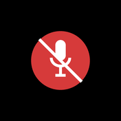

## MicToggle 1.2.1

«5 секунд после переключения» теперь задаёт показ во всех режимах.

| Микрофон включён | Микрофон выключен |
|---|---|
|  |  |

### Что изменилось

* При включённой опции значок всплывает **только после переключения** микрофона
  и висит 5 секунд — на рабочем столе, в игре, в любом режиме. Постоянного
  значка в этом режиме нет.
* Постоянное отображение (всегда / только при выключенном микрофоне / только в
  полноэкранных приложениях) — это режим с **выключенной** опцией; тогда
  соответствующие пункты меню активны, а при включённой вспышке они серые.
* «Показать на 5 секунд» в меню работает независимо от настроек.

### Установка

Скачать `MicToggle-Setup-1.2.1.exe` ниже и запустить — установка поверх
предыдущей версии сохраняет настройки.

### Контрольная сумма

```
1e1052402556215607040618e7fc9d3305c7b737526d5175e641e9da4e813842  MicToggle-Setup-1.2.1.exe
```

---

## MicToggle 1.2.0

Оверлей стал компактным и научился всплывать после переключения.

| Микрофон включён | Микрофон выключен |
|---|---|
|  |  |

### Новое

* **В оверлее остался только значок** — цветной кружок с микрофоном и мягкой
  тенью, без подписи. Меньше и не мешает картинке.
* **«5 секунд после переключения»** — новая опция (включена по умолчанию):
  после каждого переключения микрофона (клик по значку, `PgDn`, кнопка мыши)
  в углу на 5 секунд всплывает значок с новым состоянием, даже если оверлей
  настроен «только в полноэкранных приложениях». Переключение видно всегда.
* Постоянный значок по-прежнему можно ограничить полноэкранными приложениями
  или показывать только при выключенном микрофоне.

### Установка

Скачать `MicToggle-Setup-1.2.0.exe` ниже и запустить — установка поверх
предыдущей версии сохраняет настройки. Удаление — «Параметры → Приложения».

Требования: Windows 10/11 x64.

### Ограничение

Над эксклюзивным полноэкранным режимом (Fullscreen Exclusive) оверлея нет —
Windows не пускает туда чужие окна; используйте «Окно без рамки».

### Контрольная сумма

```
fc7ae8d11987675ddc9d7f2f301688a7bd9b4b7348dd9aaa07aebf83ea1d691c  MicToggle-Setup-1.2.0.exe
```

### Исходники

Тег `v1.2.0`: PyInstaller (exe) + NSIS (установщик), см. `build.ps1`.

---

## MicToggle 1.1.0

Оверлей состояния микрофона поверх игр.

### Новое

* **Оверлей в играх** — пилюля в углу экрана с цветом и подписью состояния:
  `МИКРОФОН ВЫКЛ` (красный, перечёркнутый микрофон), `МИКРОФОН ВКЛ` (зелёный),
  `СЛЫШЕН ЗВУК` (яркий зелёный), `НЕТ МИКРОФОНА` (серый).
* Клики проходят сквозь оверлей, фокус он не забирает, в Alt+Tab и на панели
  задач не появляется.
* Настройки в меню значка → «Оверлей в играх»: показывать, только при
  выключенном микрофоне, только в полноэкранных приложениях, положение (4 угла),
  «Показать на 5 секунд».
* Программа сама закрепляет свой значок в трее после установки и обновления.

### Контрольная сумма

```
5464600889c91548112eb0b820af172146a7bc4e7a9d69be73a15884aa0c66f8  MicToggle-Setup-1.1.0.exe
```

---

## MicToggle 1.0.0

Первый релиз: значок в системном трее для включения и выключения микрофона.

### Возможности

* **Клик по значку** ставит и снимает mute на устройство записи по умолчанию
  (Windows Core Audio, без прав администратора — то же, что «Выкл.» в параметрах
  звука).
* **Цвет значка** показывает состояние: красный с чертой — микрофон выключен,
  зелёный — включён и тишина, яркий зелёный с «волнами» — микрофон слышит звук,
  серый — устройство недоступно.
* **Горячие клавиши**: по умолчанию `PageDown`, назначаются из меню, можно с
  Ctrl/Alt/Shift/Win. Клавиша по умолчанию не отдаётся другим программам
  (галочка «Перехватывать клавишу» снимает это).
* **Кнопки мыши**: средняя и боковые (назад/вперёд) назначаются из меню и
  работают одновременно с клавиатурой.
* Программа сама замечает смену микрофона по умолчанию и mute, сделанный из
  системных настроек.
* Автозапуск при входе в Windows, установка в профиль пользователя без UAC.

### Контрольная сумма

```
c7445245e5f1ffbb546d89e9f5ae9c8f23b7393488b87face67242e0bf275b81  MicToggle-Setup-1.0.0.exe
```