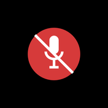

## MicToggle 1.2.0

Оверлей стал компактным и научился всплывать после переключения.

| Микрофон включён | Микрофон выключен |
|---|---|
|  |  |

### Новое

* **В оверлее остался только значок** — цветной кружок с микрофоном и мягкой
  тенью, без подписи. Меньше и не мешает картинке.
* **«5 секунд после переключения»** — новая опция (включена по умолчанию):
  после каждого переключения микрофона (клик по значку, `PgDn`, кнопка мыши)
  в углу на 5 секунд всплывает значок с новым состоянием, даже если оверлей
  настроен «только в полноэкранных приложениях». Переключение видно всегда.
* Постоянный значок по-прежнему можно ограничить полноэкранными приложениями
  или показывать только при выключенном микрофоне.

### Установка

Скачать `MicToggle-Setup-1.2.0.exe` ниже и запустить — установка поверх
предыдущей версии сохраняет настройки. Удаление — «Параметры → Приложения».

Требования: Windows 10/11 x64.

### Ограничение

Над эксклюзивным полноэкранным режимом (Fullscreen Exclusive) оверлея нет —
Windows не пускает туда чужие окна; используйте «Окно без рамки».

### Контрольная сумма

```
fc7ae8d11987675ddc9d7f2f301688a7bd9b4b7348dd9aaa07aebf83ea1d691c  MicToggle-Setup-1.2.0.exe
```

### Исходники

Тег `v1.2.0`: PyInstaller (exe) + NSIS (установщик), см. `build.ps1`.

---
